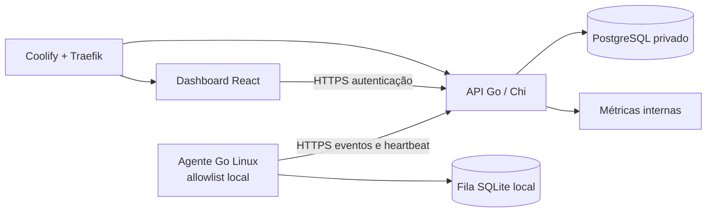

# ConfigSentinel — Planejamento completo de engenharia de software

> **Documento mestre para revisão e implementação com VS Code + Codex**  
> Versão do planejamento: 1.0 | Data: 31/10/2026 | Status: **proposto, não implementado**  
> Autor do projeto: Franklin Leandro Martins | Repositório proposto: `franklinlem/configsentinel`

## 0. Resumo executivo

O **ConfigSentinel** é uma plataforma *self-hosted* para identificar alterações em **arquivos de configuração expressamente autorizados**, registrar evidências mínimas de integridade e apresentar um histórico auditável. Um agente Linux executado com permissões restritas observa arquivos selecionados por configuração **local**, calcula hashes SHA-256 e transmite **somente metadados permitidos** à API central. Um dashboard apresenta servidores, estado de coleta, alterações, reconhecimento de eventos e alertas.

A primeira versão opera em modo **somente leitura**, **sem execução remota**, **sem download de arquivos monitorados**, **sem envio de conteúdos ou diffs ao backend**. A interface de diff textual deve ser explicitamente **pós-MVP**, feita somente para arquivos de classificação segura, com revisão humana e consentimento específico. O padrão é **hash-only**, inclusive para arquivos que aparentem ser não sensíveis.

**Stack:** Go (agente e API), PostgreSQL, React + TypeScript + Vite, Docker para central, Coolify + Traefik para hospedagem, GitHub Actions para CI. Primeira integração de laboratório: servidor Linux `frank-note2`; central em homologação na VPS Contabo, após autorização. **Nenhuma intervenção em servidores faz parte da elaboração deste plano.**

### Definição objetiva de sucesso do MVP

- Detectar modificação, criação e remoção de arquivo autorizado, distinguindo **mudança verificada** de falha de leitura.
- Bloquear localmente tentativa de monitorar caminhos fora da allowlist, links simbólicos e conteúdo sensível configurado.
- Não transmitir conteúdo, amostras, variáveis `.env`, chaves, certificados privados ou segredos.
- Garantir isolamento entre organizações, ambientes e agentes; revogação de credenciais.
- Registrar eventos com identificador idempotente, sequência por agente e trilha de auditoria.
- Tolerar queda de internet de poucos minutos sem perder eventos já persistidos na fila local, dentro da retenção/capacidade definida.
- Exibir um dashboard funcional e validar restore de PostgreSQL em ambiente isolado.

## 1. Escopo e limites

### 1.1 Incluído no MVP (P0)

1. Autenticação administrativa, organizações, projetos/ambientes e RBAC básico.
2. Cadastro lógico de servidores e instalação manual de agentes Linux com configuração local.
3. Allowlist de **caminhos absolutos de arquivos individuais**, sem wildcard nem varredura recursiva no MVP.
4. Polling periódico com `stat` + leitura por descritor, hash SHA-256, tamanho, mtime, modo e estado.
5. Detecção de `created`, `modified`, `deleted`, `unreadable`, `restored`, `baseline`, `metadata_changed` (configuráveis).
6. Eventos assinados/autenticados por token de agente com escopo; transporte TLS.
7. Fila local durável de eventos em SQLite (agente), retry com backoff e limites.
8. Ingestão idempotente, controle de sequência e persistência PostgreSQL.
9. Dashboard React com servidores, alterações, estados e filtros.
10. Reconhecimento/comentário de eventos por operador autorizado (não equivale a aprovação da mudança).
11. Alertas internos no painel para eventos novos/erro de coleta/agente offline.
12. Logs estruturados e endpoints de saúde; Docker Compose dev; testes; pipeline CI.

### 1.2 Pós-MVP (P1/P2)

- Notificações e-mail/Telegram e integração Uptime Kuma; início com saída de notificações na central, sem compartilhar conteúdo sensível.
- Inventário por política de diretórios e globs **restritos e revisados**, com proteção contra crescimento descontrolado.
- Conteúdo e diff textual opcional sob classificação formal, redaction, limites, revisão humana e RBAC separado — **não habilitado por padrão**.
- Evidência de alterações planejadas vinculadas a mudanças/deploys.
- Assinatura criptográfica de eventos com chave de agente; atestação de checkpoint; retenção imutável/WORM.
- mTLS automatizado, SSO/MFA, agentes Windows, agentes em containers, API pública para integração.
- Baselines aprovadas e políticas de *maintenance windows*; resumo de compliance.

### 1.3 Explicitamente fora do escopo

- EDR/antivírus, detecção de malware, execução de comandos, shell remoto, SSH remoto, atualização automática de arquivos, recuperação automática, coleta integral de configuração, inventário de segredos, scanner genérico do filesystem, monitoramento de payload de rede, coleta de dados de usuários.
- Atestação de integridade inviolável frente a invasor com root: um invasor privilegiado pode adulterar binário, fila ou evidências locais. A plataforma oferece sinais e auditoria, não garantia forense absoluta.

## 2. Usuários e casos de uso

| Persona | Objetivo | Acesso |
|---|---|---|
| Owner da organização | Configurar organização, agentes, membros, retenção | Total no próprio tenant |
| Admin de projeto | Gerir servidores/políticas lógicas e alertas | Projeto atribuído |
| Analyst | Investigar e reconhecer mudanças | Leitura + reconhecimento |
| Viewer | Consultar dashboards e histórico | Somente leitura |
| Agent | Publicar heartbeat/eventos do servidor vinculado | Somente ingestão, sem leitura da administração |

**UC-01:** instalar agente com allowlist local e registrar. **UC-02:** criar baseline de arquivo autorizado. **UC-03:** detectar hash divergente após edição. **UC-04:** detectar arquivo ausente e posteriormente restaurado. **UC-05:** registrar evento offline e reenviar depois da conectividade. **UC-06:** reconhecer alteração e anexar justificativa administrativa. **UC-07:** revogar credencial de agente. **UC-08:** revisar disponibilidade e falhas de monitoramento.

## 3. Requisitos funcionais rastreáveis

| ID | Pri. | Requisito | Critério de aceitação |
|---|---|---|---|
| RF-001 | P0 | Login e logout | Sessão expira e pode ser revogada |
| RF-002 | P0 | Organizações e associação de usuários | Sem vazamento entre tenants |
| RF-003 | P0 | Cadastro de projetos e ambientes | Slug único por escopo |
| RF-004 | P0 | Cadastro de servidor/agente | Identificador UUID, host alias sem expor IP por padrão |
| RF-005 | P0 | Provisionamento manual de token | Token aparece somente uma vez; banco guarda hash |
| RF-006 | P0 | Allowlist configurada localmente | Central não adiciona paths no agente |
| RF-007 | P0 | Hash SHA-256 por arquivo | Comparação de bytes, não apenas timestamp |
| RF-008 | P0 | Baseline inicial | Baseline identificada separadamente de alteração |
| RF-009 | P0 | Eventos para mudanças e erros | `modified`, `deleted`, `unreadable` e `restored` testados |
| RF-010 | P0 | Heartbeat | Última coleta e última comunicação com timestamps distintos |
| RF-011 | P0 | Fila local persistente | Eventos sobrevivem a reinício do agente |
| RF-012 | P0 | Retry idempotente | Envio duplicado não duplica evento |
| RF-013 | P0 | API de ingestão | Rejeita agent_id/tenant indevido |
| RF-014 | P0 | Dashboard | Estado, severidade, tempo, servidor, arquivos rotulados |
| RF-015 | P0 | Busca/filtros/paginação | Paginação limitada, ordenação estável |
| RF-016 | P0 | Reconhecimento de evento | Ator, instante e comentário auditados |
| RF-017 | P0 | Auditoria administrativa | Ações sensíveis registradas sem credenciais |
| RF-018 | P0 | Health/readiness/metrics | `metrics` não exposto publicamente |
| RF-019 | P1 | Alertas e canais externos | Teste controlado e throttling |
| RF-020 | P1 | Exportação JSON/CSV | Respeita escopo e minimização |
| RF-021 | P2 | Diff opcional | Não entra no MVP; revisão de privacidade obrigatória |

## 4. Requisitos não funcionais e SLOs iniciais

- **Disponibilidade alvo** da API em produção: 99,5% mensal, somente como meta após medição.
- **Ingestão:** p95 < 300 ms para lote de 100 eventos em rede local de referência, a calibrar por benchmark.
- **Detecção:** até **2 ciclos de polling** para arquivo pequeno e estável; com intervalo de 60 s, alvo prático de até 120 s, sem garantia de tempo real.
- **Escala inicial:** 5–25 agentes, 10–100 arquivos por agente, fila de 10.000 eventos/agente (limites ajustáveis depois de testes).
- **Segurança:** TLS 1.2+ (preferir 1.3), authz em toda operação, credenciais com escopo, isolamento entre tenants, proteção contra brute force, CSRF em cookies, CSP, rate limit, sessões seguras.
- **Performance:** agente com orçamento de CPU/I/O por ciclo, hash incremental em blocos, sem leitura integral em RAM.
- **Resiliência:** fila offline com backoff exponencial, jitter e limite de ocupação do disco, métricas de eventos descartados; não prometer entrega infinita.
- **Retenção:** eventos brutos 90 dias como proposta revisável; agregados e auditoria com política própria; backup não é substituto de retenção legal.
- **Acessibilidade:** meta WCAG 2.2 AA, navegação por teclado, contraste e estados não dependentes apenas de cor.
- **RPO/RTO:** inicialmente a definir e provar com teste de restauração; sugestão de referência RPO 24 h/RTO 4 h, **não garantidos**.

## 5. Arquitetura de alto nível



### Componentes e responsabilidades

1. **agent:** lê somente os caminhos locais autorizados, protege contra symlinks, calcula hash, detecta estados, mantém cursor/fila SQLite e envia lotes autenticados. Não recebe instruções que alterem allowlist nem executa comandos.
2. **api:** autenticação/sessão, RBAC, cadastro de servidores, emissão/revogação de credenciais, ingestão de eventos e heartbeat, consultas, auditoria e políticas de retenção.
3. **web:** dashboard React, indicadores, filtros, inspeção de evento, reconhecimento e administração.
4. **postgres:** fonte de verdade de organização/servidores/eventos. Sem porta pública.
5. **observability:** logs JSON, métricas Prometheus em endpoint privado, readiness/live e alerta interno.

### Princípios arquiteturais

- Modular monolith no backend, sem microserviços prematuros.
- Go API stateless exceto persistência; não depender de Redis inicialmente.
- IDs gerados no agente para idempotência; `agent_id + seq` únicos por instalação.
- Tempo do servidor é a referência para **recebimento**; hora do agente preservada separadamente e comparada com tolerância de clock drift.
- Hash de conteúdo não demonstra autoria, legitimidade ou ausência de intrusão.

## 6. Agente Linux — especificação detalhada

### 6.1 Configuração local proposta (`agent.yaml`)

```yaml
agent:
  server_url: https://configsentinel-dev.franklem.uk/api/v1
  agent_id: "00000000-0000-4000-8000-000000000001" # gerado no provisionamento
  token_file: /etc/configsentinel/agent.token
  interval_seconds: 60
  max_file_bytes: 10485760
  max_files: 100
  max_queue_events: 10000
  queue_db: /var/lib/configsentinel/events.sqlite
  send_batch_size: 100
monitoring:
  files:
    - path: /etc/ssh/sshd_config
      alias: sshd-config
      hash_only: true
    - path: /etc/systemd/system/example.service
      alias: example-service
      hash_only: true
  deny_prefixes:
    - /home
    - /root
    - /proc
    - /sys
    - /run/secrets
    - /var/lib/private
  deny_globs:
    - "*.env"
    - "*private*key*"
    - "*.pem"
    - "*.p12"
    - "id_*"
```

**Exemplos ilustrativos, não instalar sem revisão:** `sshd_config` e arquivos systemd podem conter informações sensíveis e sua leitura depende das permissões. O agente somente deve receber acesso a arquivos selecionados após revisão. A allowlist local precisa ser restrita por path e **por tipo**, e a denylist é defesa adicional, nunca critério único de autorização. Para arquivo não legível, enviar `unreadable`, sem escalar privilégios automaticamente.

### 6.2 Regras críticas de acesso a arquivos

- Agente roda com usuário dedicado `configsentinel` e sem root/sudo, salvo desenho futuro formalmente aprovado.
- Não usar grupos privilegiados, acesso ao socket Docker ou execução de comandos recebidos da central.
- Desativar monitoramento de diretórios completos, wildcard, glob e recursividade no MVP.
- Resolver e validar caminho absoluto **sem confiar somente em `filepath.Clean`/`EvalSymlinks`**, que são vulneráveis a troca por symlink (TOCTOU).
- Usar abertura protegida contra symlink, idealmente `openat2` no Linux com flags adequadas (`RESOLVE_NO_SYMLINKS`, `RESOLVE_BENEATH` quando apropriado) ou alternativa segura comprovada e testada; validar descriptor via `fstat`, tipo regular, tamanho máximo e inode.
- Não seguir hardlinks para arquivos fora da política: caminho permitido **não garante conteúdo não sensível**; documentar limites de hardlinks e preferir permitir somente arquivos controlados pelo administrador.
- Nunca abrir sockets, dispositivos, FIFOs ou arquivos especiais como conteúdo regular.
- Ler em blocos com deadline/limite de bytes; aceitar alteração concorrente marcando `unstable` e reavaliando no próximo ciclo.
- Não ler/conservar payload. Snapshot local guarda último hash/metadata, **não o conteúdo**.
- Hashes de conteúdo de baixa entropia podem revelar igualdade/identidade; tratar hashes e nomes como metadados sensíveis.
- Redigir nome/alias no dashboard em vez de caminho completo por padrão. Caminho completo fica acessível só a perfis autorizados.
- `systemd` com `NoNewPrivileges=true`, `ProtectSystem=strict`, `ProtectHome=true`, `PrivateTmp=true`, `RestrictAddressFamilies=AF_INET AF_INET6 AF_UNIX`, capacidades vazias, exceções de leitura aprovadas e `StateDirectory=configsentinel`; validar compatibilidade com os paths monitorados.

### 6.3 Máquina de estados

```text
UNSEEN --arquivo válido--> BASELINE
UNSEEN --inexistente--> MISSING_INITIAL
BASELINE --hash mudou--> MODIFIED
BASELINE --metadados mudaram, hash igual--> METADATA_CHANGED (se habilitado)
PRESENT --ausente--> DELETED
DELETED --reaparece--> RESTORED
PRESENT --falha de leitura--> UNREADABLE
UNREADABLE --leitura volta--> RECOVERED / MODIFIED conforme hash anterior
PRESENT --mudança durante hash--> UNSTABLE (não confirmar novo hash)
```

**Polling vs eventos FS:** polling é a fonte de verdade inicial. `fsnotify/inotify` pode atuar futuramente como acelerador, nunca como único mecanismo (perda de eventos, reinício, renomeações).

### 6.4 Fila local e sincronização

- SQLite com WAL, `event_uuid`, `agent_id`, `sequence`, `observed_at`, `payload_minimal`, `attempts`, `acked_at`.
- Enfileirar evento e atualizar snapshot **na mesma transação local**, quando aplicável.
- Batch limitado com autenticação e idempotency. API retorna eventos aceitos/duplicados/rejeitados de maneira explícita.
- Em falha de rede: retry exponencial com jitter; não descartar silenciosamente; expor métricas de ocupação e queda.
- Clock fora de sincronismo deve gerar `clock_skew_warning` e usar `received_at` para ordenação administrativa.
- Ao reiniciar, carregar snapshot e revalidar allowlist; mudanças locais na lista precisam ser auditadas em log local.
- Rotação de token/agent-id segue procedimento manual e não apaga eventos pendentes sem backup e aprovação.

## 7. Modelo de dados PostgreSQL

| Entidade | Campos principais | Restrição/regra |
|---|---|---|
| organizations | id uuid, slug, name, created_at | `UNIQUE(slug)` |
| users | id, email, password_hash, disabled_at | e-mail único normalizado |
| memberships | organization_id, user_id, role | chave composta; role verificada |
| projects | id, organization_id, name, slug | `UNIQUE(organization_id,slug)` |
| environments | id, project_id, name, slug | `UNIQUE(project_id,slug)` |
| servers | id, environment_id, display_name, status, created_at | identificador opaco |
| agents | id, server_id, installation_id, last_seen_at, agent_version, revoked_at | uma instalação ativa identificável |
| agent_tokens | id, agent_id, prefix, secret_hash, scopes, expires_at, revoked_at | segredo nunca em claro |
| monitored_files | id, agent_id, file_alias, path_display_redacted, enabled | **registro informativo**, não controle remoto |
| file_observations | id, agent_id, file_alias, sha256, size, mode, mtime, state, observed_at, received_at | hash opcional em falhas |
| change_events | id, agent_id, sequence, event_uuid, file_alias, kind, old_hash, new_hash, occurred_at, received_at, severity | `UNIQUE(agent_id, sequence)` e `UNIQUE(agent_id,event_uuid)` |
| acknowledgements | id, event_id, actor_id, comment, created_at | histórico separado |
| alert_rules | id, organization_id, event_kinds, severity, enabled | P1 externas, P0 internas |
| alerts | id, rule_id, event_id, status, created_at | evitar duplicatas |
| audit_logs | id, organization_id, actor_id, operation, target_type, target_id, data_redacted, timestamp | append-only na aplicação |
| user_sessions | id, user_id, token_hash, expires_at, revoked_at | revogação suportada |

**Chaves estrangeiras e tenant:** nunca confiar no `organization_id` recebido no corpo. API deriva escopo da sessão/token e verifica joins. O banco deve validar vínculos de agente e servidor/ambiente. Todas as tabelas têm índices para filtros frequentes e paginação cursor. Sem armazenar conteúdo dos arquivos monitorados.

### Exemplo de migrations para núcleo (não substitui migrations completas)

```sql
CREATE TABLE organizations (
  id uuid PRIMARY KEY,
  slug text NOT NULL UNIQUE,
  name text NOT NULL,
  created_at timestamptz NOT NULL DEFAULT now()
);
CREATE TABLE projects (
  id uuid PRIMARY KEY,
  organization_id uuid NOT NULL REFERENCES organizations(id),
  slug text NOT NULL,
  name text NOT NULL,
  UNIQUE(organization_id, slug)
);
CREATE TABLE environments (
  id uuid PRIMARY KEY,
  project_id uuid NOT NULL REFERENCES projects(id),
  slug text NOT NULL,
  name text NOT NULL,
  UNIQUE(project_id, slug)
);
CREATE TABLE servers (
  id uuid PRIMARY KEY,
  environment_id uuid NOT NULL REFERENCES environments(id),
  display_name text NOT NULL,
  created_at timestamptz NOT NULL DEFAULT now()
);
CREATE TABLE agents (
  id uuid PRIMARY KEY,
  server_id uuid NOT NULL REFERENCES servers(id),
  installation_id uuid NOT NULL UNIQUE,
  last_seen_at timestamptz,
  revoked_at timestamptz
);
CREATE TABLE change_events (
  id uuid PRIMARY KEY,
  agent_id uuid NOT NULL REFERENCES agents(id),
  sequence bigint NOT NULL CHECK (sequence > 0),
  event_uuid uuid NOT NULL,
  file_alias text NOT NULL,
  kind text NOT NULL,
  old_hash char(64),
  new_hash char(64),
  occurred_at timestamptz NOT NULL,
  received_at timestamptz NOT NULL DEFAULT now(),
  UNIQUE(agent_id, sequence),
  UNIQUE(agent_id, event_uuid)
);
CREATE INDEX idx_change_events_agent_time
ON change_events(agent_id, received_at DESC);
```

## 8. API REST e OpenAPI

**Base:** `/api/v1`; contrato **OpenAPI 3.1.2** (ou versão adotada de forma explícita na implementação). JSON; erros RFC 9457 `application/problem+json`. Auth admin via sessão cookie `HttpOnly`, `Secure`, `SameSite` e CSRF; agente via `Authorization: Bearer` com token restrito e hash no banco. Retornar `401`, `403`, `404` (ocultando recursos alheios), `409`, `422`, `429` conforme o caso. Nunca aceitar `agent_id` do corpo para decidir identidade — derivá-la do token.

| Método | Caminho | Autorização | Operação |
|---|---|---|---|
| POST | `/auth/login` | Público | Abrir sessão |
| POST | `/auth/logout` | Admin | Revogar sessão |
| GET | `/me` | Admin | Perfil e permissões |
| GET/POST | `/organizations` | Admin | Listar/criar organizações |
| GET/POST | `/organizations/{orgId}/projects` | Owner/Admin | Projetos |
| GET/POST | `/projects/{projectId}/environments` | Admin | Ambientes |
| GET/POST | `/environments/{envId}/servers` | Admin | Servidores |
| GET | `/servers/{serverId}` | Viewer+ | Detalhes |
| POST | `/servers/{serverId}/agents` | Admin | Provisionar agente |
| POST | `/agents/{agentId}/tokens` | Admin | Rotacionar token |
| DELETE | `/agents/{agentId}/tokens/{tokenId}` | Admin | Revogar token |
| GET | `/servers/{serverId}/observations` | Viewer+ | Últimas observações |
| GET | `/events` | Viewer+ | Eventos filtrados por escopo |
| GET | `/events/{eventId}` | Viewer+ | Evento específico |
| POST | `/events/{eventId}/acknowledgements` | Analyst+ | Reconhecimento |
| GET | `/alerts` | Viewer+ | Alertas |
| GET | `/organizations/{orgId}/audit-logs` | Admin/Owner | Auditoria |
| POST | `/agent/events:batch` | Agent token | Receber eventos idempotentes |
| POST | `/agent/heartbeat` | Agent token | Heartbeat |
| GET | `/health/live` | Público | Liveness |
| GET | `/health/ready` | Interno | Readiness |
| GET | `/metrics` | Interno | Métricas |

### Payload de ingestão (exemplo)

```json
{
  "batch_id": "7ceced42-6d73-4300-b1d0-30f3516a7391",
  "schema_version": 1,
  "events": [
    {
      "event_uuid": "0c929f11-a92a-4359-bccc-9e6bc5da6e31",
      "sequence": 91,
      "file_alias": "sshd-config",
      "kind": "modified",
      "old_sha256": "aaaaaaaaaaaaaaaaaaaaaaaaaaaaaaaaaaaaaaaaaaaaaaaaaaaaaaaaaaaaaaaa",
      "new_sha256": "bbbbbbbbbbbbbbbbbbbbbbbbbbbbbbbbbbbbbbbbbbbbbbbbbbbbbbbbbbbbbbbb",
      "file_size": 3292,
      "observed_at": "2026-10-31T15:20:00Z"
    }
  ]
}
```

**Resposta:** `202 Accepted` com IDs aceitos, duplicados e inválidos; para erros temporários usar 503/429 com orientação de retry. **Mesma sequência com payload divergente:** rejeitar e alertar possível adulteração/reuso indevido. Limitar payload total e eventos por lote. Heartbeat informa status, fila pendente e horário observado, nunca lista de paths sensíveis.

### Fragmento OpenAPI inicial

```yaml
openapi: 3.1.2
info:
  title: ConfigSentinel API
  version: 0.1.0
servers:
  - url: https://configsentinel-dev.franklem.uk/api/v1
paths:
  /agent/heartbeat:
    post:
      operationId: postAgentHeartbeat
      security:
        - agentBearer: []
      requestBody:
        required: true
        content:
          application/json:
            schema:
              $ref: '#/components/schemas/Heartbeat'
      responses:
        '202':
          description: Heartbeat accepted
        '401':
          description: Invalid agent token
        '429':
          description: Too many requests
components:
  securitySchemes:
    agentBearer:
      type: http
      scheme: bearer
  schemas:
    Heartbeat:
      type: object
      additionalProperties: false
      required: [agent_version, queue_depth, observed_at]
      properties:
        agent_version: { type: string, maxLength: 40 }
        queue_depth: { type: integer, minimum: 0 }
        observed_at: { type: string, format: date-time }
```

**Obrigação na etapa de implementação:** completar `api/openapi.yaml` com **todos** os endpoints listados, schemas de request/response, autenticação admin, CSRF, paginação, códigos de erro, exemplos e contratos de versão. O fragmento acima é apenas um ponto de partida.

## 9. Dashboard — telas e jornadas

1. **Login:** sessão e recuperação de acesso administrativa, erros não enumeráveis.
2. **Visão geral:** agentes online/offline/atrasados, eventos recentes, falhas de leitura, fila acumulada, evolução por período.
3. **Projetos/ambientes:** dev, homologação e produção claramente sinalizados; nunca depender só de cor.
4. **Servidores:** nome lógico, últimas observações, última comunicação, agente/versão, sem divulgar IP por padrão.
5. **Arquivos monitorados:** alias, último hash abreviado, último resultado, **sem visualizador de conteúdo**.
6. **Eventos:** busca, filtros de servidor/ambiente/tipo/tempo; linha do tempo e detalhes.
7. **Reconhecimento:** comentário, justificativa, usuário e data; não remove evento.
8. **Credenciais:** emissão uma vez, rotação, revogação; token nunca reaparece.
9. **Auditoria:** alterações de usuários, tokens, cadastros e reconhecimentos.
10. **Estados:** carregamento, vazio, erros de rede, acesso negado e versão incompatível do agente.

Design mobile-first para consulta; operações sensíveis confortáveis em desktop/tablet. Usar TanStack Query e React Router; React Hook Form + Zod para formulários; componentes com teclado, aria labels e confirmação contextual. Internacionalização pt-BR inicial, estrutura preparada para en-US.

## 10. Segurança e threat model

| Ameaça | Mitigação concreta | Teste exigido |
|---|---|---|
| Controle remoto arbitrário via agente | Protocolo unidirecional de eventos, sem comandos | Instruções de servidor rejeitadas |
| Leitura fora da allowlist | Paths fixos locais + abertura segura sem symlink | Path traversal e troca de symlink |
| Vazamento de segredos | Hash-only, sem conteúdo/diff, bloqueio de paths sensíveis | Inspeção de tráfego/logs sem conteúdo |
| Roubo de token | Token aleatório, hash armazenado, escopo de agente e revogação | Token de agente A não age como B |
| IDOR e tenant escape | Authz por joins e escopo derivado | Usuário A não consulta B |
| Replay/duplicação | UUID + seq por agente, unique constraints | Envio duplicado idempotente |
| Adulteração de evento | Conflito de sequência detectado e auditado | Mesmo seq com payload diferente falha |
| Manipulação de clock | `observed_at` e `received_at` separados | Alerta de clock skew |
| DoS | Rate limit, batch, limites de arquivo e fila | Teste de payload/carga |
| Privilege escalation | User dedicado, systemd sandbox, sem Docker socket/sudo | Verificação de permissões |
| Alteração de banco por invasor | Auditoria separada e backup; ancoragem externa P2 | Documentar limite de confiança |
| Dependências vulneráveis | SCA, SBOM, atualização e pinning | Gate CI em vulnerabilidades críticas |

**Segredos:** senha admin com Argon2id, token do agente de alta entropia, hash de token em PostgreSQL, TLS, rotação e revogação. Administrador utiliza cookies seguros e CSRF. Registros de auditoria não guardam segredos. LGPD: inventário de dados tratados, base legal, política de retenção, direito de acesso e exclusão aplicáveis; DPIA/RIPD quando necessário. O servidor central nunca deve coletar conteúdo de `.env`, chaves privadas, dumps, arquivos pessoais nem dados operacionais sensíveis.

## 11. Estratégia de testes e qualidade

| Camada | Cenários | Ferramentas sugeridas |
|---|---|---|
| Unitário agente | hash, estados, fila, limites, aliases, backoff | `go test -race`, fuzzing |
| FS seguro | symlink, hardlink, file swap, permissões, FIFO, arquivo que muda durante hash | Testes Linux isolados |
| Unitário API | validação, RBAC, idempotência, filtros | Go tests |
| Integração banco | migrations, constraints, isolamento tenants | Testcontainers/PostgreSQL real |
| Contrato | OpenAPI, JSON schemas, erros e autenticação | Spectral e contract tests |
| Frontend | formulários, filtros, a11y, estados de erro | Vitest, Testing Library, axe |
| E2E | provisionar agente → baseline → alterar → receber → reconhecer | Playwright + ambiente de teste |
| Offline | 1–3 min sem rede, reinício, reenvio, fila saturada | Proxy de falhas/netem em sandbox |
| Carga | até 25 agentes e lotes, percentis, throughput | k6 |
| Segurança | DAST homologação, secret scan, SAST/SCA, fuzzing | Gosec, govulncheck, Gitleaks, scanners equivalentes |
| Disaster recovery | backup, restore, versões compatíveis | Scripts isolados e checklist |

**Cenários de aceitação ponta a ponta:** (a) baseline não dispara falsa mudança; (b) alteração detectada no segundo ciclo; (c) arquivo removido e restaurado; (d) agente offline por reinício de roteador, eventos preservados; (e) credencial revogada bloqueia novos eventos; (f) agente com path proibido não lê; (g) incidente reconhecido não desaparece; (h) isolamento entre organizações testado.

**Gates:** CI verde; cobertura orientativa ≥80% para avaliador de estados e autorização; zero defeitos críticos conhecidos; revisão de permissões; restore testado. Cobertura numérica não substitui testes adversariais.

## 12. Estrutura de repositório sugerida

```text
configsentinel/
├── apps/
│   ├── api/
│   │   ├── cmd/server/
│   │   ├── internal/{auth,tenancy,agents,events,alerts,audit,http,storage}/
│   │   └── go.mod
│   ├── agent/
│   │   ├── cmd/configsentinel-agent/
│   │   ├── internal/{config,fssecure,scanner,baseline,queue,transport}/
│   │   ├── packaging/systemd/
│   │   └── go.mod
│   └── web/
│       ├── src/{app,api,features,components,styles}/
│       └── package.json
├── api/openapi.yaml
├── db/migrations/
├── deploy/{compose.dev.yml,compose.prod.example.yml,coolify.md}/
├── docs/
│   ├── architecture.md
│   ├── threat-model.md
│   ├── agent-security.md
│   ├── implementation-plan.md
│   ├── adr/
│   └── runbooks/{installation,incident,backup,restore,rollback}.md
├── tests/{fixtures,e2e,load}/
├── .github/workflows/
├── .env.example
├── .gitignore
├── Makefile
├── LICENSE
└── README.md
```

**Decisão monorepo:** módulos Go separados (`apps/api`, `apps/agent`) permitem build e distribuição independentes. Pode haver `go.work` somente em desenvolvimento. Dependências em lockfiles/Go sums.

## 13. CI/CD e qualidade de entrega

**Pull Request:** `gofmt`, `go vet`, testes race, lint, testes frontend, typecheck, cobertura crítica, validação OpenAPI, secret scan, revisão de vulnerabilidades. **Main:** build de binários Linux amd64/arm64 do agente, imagens Docker multi-stage da central, SBOM, escaneamento das imagens, publicação em registry por digest. **Release:** tag SemVer, changelog, checksum SHA-256 de binários e notas de compatibilidade agente/servidor. **Deploy:** homologação antes de produção; promoção da **mesma imagem** já validada; aprovação humana para produção. Evitar comandos CI de fork não confiável com secrets.

## 14. Desenvolvimento local com VS Code + Codex

### Pré-requisitos

- Git, Go estável com correções de segurança, Node.js LTS, Docker Engine/Compose plugin, VS Code e Codex.
- Recomenda-se Go 1.27.3 ou patch estável superior suportado no momento da implementação; não fixar Node/PostgreSQL sem validar compatibilidade da stack.
- Criar pasta em disco com espaço suficiente e permissões normais de usuário; não trabalhar como root.
- Utilizar `docker compose -f deploy/compose.dev.yml up --build` apenas após revisar o Compose gerado.

### Sequência para Codex

1. Ler este documento inteiro; extrair backlog para `docs/implementation-plan.md`.
2. Criar ADRs de arquitetura e modelo de ameaças antes de código com permissões.
3. Construir Compose dev, API Go, PostgreSQL, migrations e healthchecks.
4. Implementar agente local **em diretório de testes temporário**, sem ler `/etc` ou `/home` reais durante desenvolvimento.
5. Construir ingestão, idempotência e fila offline; realizar testes adversariais.
6. Implementar frontend, RBAC, dashboard e alertas internos.
7. Validar CI, documentação, build de binários e runbooks.
8. Só então planejar homologação externa; **não instalar em servidores reais sem autorização específica**.

### Prompt de abertura para Codex

```text
Atue como engenheiro de software sênior e arquiteto de segurança.
Leia integralmente docs/ConfigSentinel_Plano_Completo_Engenharia_Software.md.
Crie docs/implementation-plan.md, ADRs iniciais e backlog rastreável.
Primeiro entregue monorepo, Compose de desenvolvimento, esqueleto Go/React,
migrations, OpenAPI inicial, testes e README.
No agente, use apenas arquivos de fixtures temporárias nos testes;
não leia configurações reais do host, não use sudo, SSH ou Docker socket.
Não implemente coleta de conteúdo nem diff textual. Não permita comandos remotos.
Não instale serviços, não altere DNS, Coolify nem produção nesta etapa.
Mostre os testes executados e os resultados; explique decisões pendentes.
```

## 15. Plano de implantação na VPS Contabo com Coolify

### 15.1 Ambientes propostos

| Ambiente | Domínio **proposto** | Uso |
|---|---|---|
| Dev local | localhost, portas restritas | Desenvolvimento e CI |
| Homologação | `configsentinel-dev.franklem.uk` | Validar API, agente e dashboard |
| Produção | `configsentinel.franklem.uk` | Somente após aceitação |

Os domínios **não estão declarados como existentes**. Não reaproveitar credenciais nem banco de projetos atuais. Confirmar a topologia Coolify/Traefik e a disponibilidade de recursos antes de implantar.

### 15.2 Desenho de rede

```text
Internet -> Traefik HTTPS -> Web React / API Go
                                |
                                +--> rede privada --> PostgreSQL
Agentes Linux --> HTTPS de saída --> API Go
Prometheus/metrics: interno; sem porta pública
```

- Publicar somente frontend/API por Traefik, com rotas de ingestão protegidas. Sem abrir porta do PostgreSQL à internet.
- Usar volumes persistentes para banco e snapshots; Compose não garante persistência sem volume/bind mount.
- Isolar homologação e produção em recursos Coolify separados com DB, secrets e redes próprios.
- Agente **não** deve residir no container do Hermes e não deve herdar permissões remotas do Hermes. Se instalado em `frank-note2`, executar como serviço systemd independente em modo restrito.
- Não alterar reinício diário do roteador; tolerar quedas curtas por fila offline e retry.

### 15.3 Passos planejados de homologação

1. Inventariar aplicações e consumo de RAM/CPU/disco da VPS; checar backups atuais, TLS, DNS e saúde do Coolify.
2. Criar branch/tag de release e imagens imutáveis após CI; revisar `compose.prod.example.yml` e `Dockerfile`.
3. Provisionar PostgreSQL privado separado no Coolify; configurar volume e backup.
4. Configurar segredos no gerenciador do Coolify: `DATABASE_URL`, segredo da sessão, CSRF, origens permitidas, URL pública. Nunca pôr segredos em Git.
5. Configurar registros DNS de homologação, HTTPS, headers, proxy e healthchecks.
6. Rodar migrations controladas; subir API e frontend por imagens fixadas por digest.
7. Executar smoke tests HTTP e testes completos de autorização/isolamento e ingestão.
8. Instalar **apenas em ambiente de teste autorizado** o agente com uma fixture sintética, token restrito e sem acesso a arquivos de produção.
9. Simular offline, eventos duplicados, revogação e alteração de arquivo autorizado; verificar dashboard e métricas.
10. Validar `pg_dump -Fc`, restauração isolada, versionamento e rollback de imagem.
11. Apresentar checklist de aceite antes de produzir qualquer mudança em produção.

### 15.4 Backups e rollback

- Backups lógicos PostgreSQL com retenção proposta de 7 diários e 4 semanais; cópia criptografada fora da VPS após confirmar política operacional.
- Testes de restore em banco isolado; guardar hashes de arquivos de backup e evidência da restauração.
- Fazer migrations expand/contract e compatibilidade entre versão antiga/nova da API. Rollback de imagem **não reverte schema**.
- Agente conserva fila offline e baseline; atualização deve manter compatibilidade de schema do SQLite com migração e backup antes de upgrade.
- Runbooks para DB indisponível, agente não comunica, token comprometido, perda de fila, suspeita de violação e reversão de release.

## 16. Observabilidade e operação

**Métricas centrais:** `events_ingested_total`, `event_ingest_errors_total`, `ingest_duration_seconds`, `agents_last_seen_age_seconds`, `agents_offline_total`, `postgres_pool_in_use`, `alerts_open_total`.  
**Métricas agente:** `scan_duration_seconds`, `files_monitored`, `files_unreadable`, `queue_depth`, `queue_dropped_total`, `send_retry_total`, `agent_clock_skew_seconds`.  
**Cardinalidade:** não incluir path, hash, user-id ou token como labels Prometheus.  
**Alertas iniciais:** agente offline > 5 min (limiar inicial, ajustável considerando reboot do roteador), fila > 80%, erro de leitura persistente, 5xx/API não saudável, disco/DB perto do limite.

## 17. Roadmap, sprints, entregáveis e dependências

| Etapa | Entrega | Critério de conclusão | Esforço indicativo |
|---|---|---|---|
| 0. Discovery | ADRs, threat model, wireframes, OpenAPI | Escopo MVP revisado | 2–4 dias |
| 1. Fundação | Repo, CI, Go API, React, Postgres, migrations | Compose e testes básicos verdes | 4–6 dias |
| 2. Auth/RBAC | Usuários, organizações, escopos, tokens | Testes de isolamento e revogação | 5–8 dias |
| 3. Agent Core | Allowlist, FS seguro, baseline, hash, SQLite | Testes Linux adversariais | 7–12 dias |
| 4. Ingestão | Batch, seq, idempotência, heartbeat | E2E alteração→banco | 4–7 dias |
| 5. Dashboard | Listas, eventos, filtros, reconhecimento | E2E e acessibilidade | 5–8 dias |
| 6. Operação | Alertas, métricas, observabilidade, retenção | Testes de falha e carga | 4–6 dias |
| 7. Homologação | Coolify, TLS, DNS, backup/restore | Smoke, segurança e rollback | 3–5 dias |
| 8. Produção | Aceite, release, runbooks | Checklist de go-live completo | 2–4 dias |

**Estimativa:** 36–60 dias úteis de esforço, variável conforme dedicação; trabalho com Codex pode acelerar implementação, mas não elimina revisão de segurança. A etapa 8 depende de autorização específica.

### Issues iniciais do GitHub

1. Criar monorepo e README.
2. Criar OpenAPI integral e contratos de erro.
3. Modelar banco e migrations com testes.
4. Implementar login/sessão/RBAC.
5. Implementar cadastro de servidores e provisionamento seguro.
6. Projetar API de eventos idempotentes.
7. Implementar leitura segura por allowlist e fixtures Linux.
8. Implementar baseline/estado e fila offline SQLite.
9. Implementar transporte HTTPS, retry e heartbeat.
10. Implementar dashboard e reconhecimento de eventos.
11. Implementar auditoria, alertas internos e métricas.
12. Implementar E2E, segurança e CI/CD.
13. Documentar implantação Coolify, backup e restore.
14. Ensaiar rollback, preparar release e auditoria final.

## 18. Matriz de rastreabilidade e critérios de aceite

| História | Requisitos | Testes | Evidência |
|---|---|---|---|
| Agente seguro | RF-006/007 | FS sandbox, symlink/race, permissions | Relatório CI Linux |
| Mudança detectada | RF-008/009 | fixture alterada após baseline | Evento persistido |
| Offline sem perda | RF-010/011/012 | queda 3 min + restart + retry | fila esvazia após ACK |
| Ingestão segura | RF-013 | token revogado, cross-tenant, duplicate | 401/403/409 esperados |
| Operação no painel | RF-014/015/016/017 | Playwright com RBAC | log + captura de E2E |
| Recuperação | RF-018 + NFR | backup e restore | checklist assinado |

### Definition of Done

Uma entrega só estará concluída quando: código revisado, teste automatizado aplicável aprovado, política de autorização validada, logs sem segredos, documentação e contrato API atualizados, migrações consideradas, UX acessível, CI verde e comportamento em falha documentado. **Nenhuma instalação em servidor real e nenhum deploy externo sem aprovação explícita.**

## 19. Decisões para revisão antes do desenvolvimento

1. **Tenancy:** organização/projeto/ambiente desde o início ou versão single-tenant inicial? Recomendado manter tenancy no modelo, mesmo com apenas uma organização.
2. **Observação:** intervalo padrão 60 s e tamanho máximo 10 MB por arquivo; ajustar conforme desempenho.
3. **Escopo de paths:** apenas arquivos de demonstração no MVP; permitir `sshd_config` no piloto real somente após revisão de permissões e classificação de dados.
4. **Credenciais:** bearer restrito inicialmente; mTLS mais tarde. Avaliar fluxo de provisionamento/rotação antes da instalação.
5. **Retenção:** 90 dias de eventos como default proposto; ajustar por espaço, valor operacional e obrigações aplicáveis.
6. **Alertas externos:** Telegram/Uptime Kuma somente P1; evitar duplicidade com monitoramento que já existe.
7. **Licença open source:** proposta Apache-2.0 ou MIT, após revisão de dependências, marca e modelo comercial.
8. **Plataforma de agente:** Linux/systemd inicial; Windows em fase posterior.
9. **Caminhos monitorados:** lista será definida separadamente por servidor; nunca conceder acesso amplo para acelerar a implementação.
10. **Produção:** manter homologação isolada até ter testes de segurança e restore aprovados.

## 20. Referências técnicas verificadas

- Go — histórico de versões e política de suporte: https://go.dev/doc/devel/release
- OpenAPI — especificação oficial: https://spec.openapis.org/oas/
- OpenAPI 3.1.2: https://spec.openapis.org/oas/v3.1
- Coolify — Docker e containers: https://coolify.io/docs/core/docker-and-containers
- OWASP ASVS: https://owasp.org/www-project-application-security-verification-standard/
- OWASP API Security Top 10: https://owasp.org/API-Security/
- Linux `openat2`: https://man7.org/linux/man-pages/man2/openat2.2.html
- systemd.exec: https://www.freedesktop.org/software/systemd/man/latest/systemd.exec.html
- PostgreSQL documentation: https://www.postgresql.org/docs/
- Go security guidance: https://go.dev/doc/security/

**Verificação final:** este arquivo é uma especificação de arquitetura e implementação. Nenhum repositório, domínio, container, banco, agente, regra de firewall ou serviço foi criado/alterado durante sua elaboração. A revisão deve ocorrer antes do primeiro comando de implantação.
