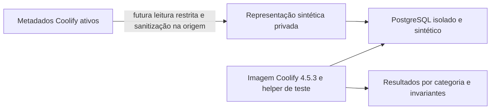

# ConfigSentinel RC2 — plano do clone de diagnóstico J5

Estado: **PLANEJAMENTO; execução não autorizada**. Base: commit `ea54917`, Coolify instalado 4.5.3 e evidências em [j5-diagnostic](evidence/j5-diagnostic/diagnostic.json). Este documento não autoriza extração, criação de recursos ou mudança operacional. O recurso de homologação é `oi6lvzwzomwtbbgzf5uzofuh`; seu identificador serve aqui apenas para delimitar o escopo, não como dado a transportar ao clone.

A última evidência registra J3 e J4 aprovados, API/web interrompidas, J5 com rollback e nenhum deploy enfileirado. São observações históricas, não uma confirmação do estado atual. A causa do `internal_error` permanece desconhecida: o ensaio anterior com a mesma imagem do Coolify e PostgreSQL sintético usou esquema parcial. Um buffer com conteúdo consegue produzir erro semelhante, mas o bootstrap observado tinha buffer vazio; isso não prova a causa da execução ativa. Não há stdout/stderr bruto recuperável daquela tentativa.

## Arquitetura proposta



Uma futura execução exige autorização específica para leitura e criação. O processo sanitizador produzirá somente dados sintéticos; nem valores reais, ciphertext, chaves, tokens, URLs privadas, nomes de servidores, domínios, IDs reais nem dumps do banco compartilhado sairão da origem. O clone usará uma rede Docker interna exclusiva, sem portas publicadas, sem rede dos serviços existentes, sem socket Docker, sem mounts do ambiente ativo e sem acesso à internet, host ou serviços reais. A conectividade negativa deverá ser testada: `--internal` sozinho não demonstra impossibilidade de alcançar o host. Não iniciar workers, scheduler, proxy, servidor web ou deploy; executar apenas o PHP necessário. Não executar os comandos de build/start salvos como metadados.

Usar a imagem exata 4.5.3 e a família PostgreSQL 15 comprovadas na evidência anterior, verificando seus IDs/digests antes da execução. Novo PostgreSQL sintético, credenciais e `APP_KEY` novos; dados em tmpfs ou armazenamento exclusivo limitado. O uso de tmpfs implica perda ao parar/remover: qualquer destruição de recursos criados depende de autorização explícita posterior. Um identificador sintético consistente substituirá o UUID real em todo o grafo e nos comandos armazenados, sem tocar no recurso real.

O helper atual só aceita o UUID real no modo `active` e só aceita `isolated` com SQLite `:memory:` e UUID específico. Para PostgreSQL e identificadores sintéticos será necessária uma adaptação **de teste** estritamente limitada à vinculação do alvo e do comando de projeto, revisada e com diff e hashes registrados. Ela não é o helper byte a byte executado no ativo: testar também o original em seu modo isolado e registrar essa limitação. Nenhuma alteração deve enfraquecer o guard do helper operacional; a conexão sintética e o bloqueio de rede serão verificados antes de qualquer teste. Injeções de falha para PostgreSQL devem existir apenas no harness de teste, pois o helper proíbe `injectFailure` no modo ativo.

## Dependências e recorte mínimo

A lista abaixo é um mapa de partida derivado dos scripts e do código instalado, não substitui o inventário do catálogo. Antes da construção, levantar somente metadados de esquema e código necessários: tipos, nulidade, defaults, índices, FKs, constraints, triggers, versões de migrations e relações efetivamente consultadas. Não copiar uma base integral. Os nomes/colunas devem ser confirmados na versão instalada; um erro de relação ausente não é licença para ampliar indiscriminadamente a leitura.

| Conjunto | Necessidade e cardinalidade inicial |
|---|---|
| `applications` | Uma aplicação sintética com campos consultados/gravados: UUID, branch, commit, localização Compose, comandos, estado de soft delete e FKs obrigatórias. Preservar a transição RC1 → RC2 e campos de comparação por valor sintético quando forem identificadores. |
| `application_settings` | A configuração associada, inclusive `is_raw_compose_deployment_enabled`, `is_build_server_enabled`, `is_auto_deploy_enabled`; preservar cardinalidade e flags observadas. |
| `environment_variables` | Linhas não preview relacionadas polimorficamente à aplicação, incluindo as três chaves existentes e as sete pretendidas, sem pressupor ausência ou unicidade: preservar quantidades, chaves necessárias, flags, nullabilidade e relações. A senha PostgreSQL sintética deve coincidir no registro e payload; runtime/migrator devem ser distintos e satisfazer as validações. |
| `application_deployment_queues` | Apenas dados estruturais e contagens por status pertinentes ao recurso; filas sintéticas para casos vazio, `queued` e `in_progress`. Não copiar payloads ou logs. |
| Relações adicionais do modelo | `additional_destinations`, destinos/redes e servidores necessários aos `withCount`/FKs do modelo `Application`; incluir somente o fecho referencial obrigatório. Relações de ambiente, projeto e equipe podem ser necessárias por constraints/serialização ou para a alternativa nativa: representar sinteticamente, sem copiar integrações, chaves ou credenciais. |

Confirmar no catálogo e models também defaults, relações polimórficas, índices únicos, cascatas e eventual presença de registros soft-deleted. Onde dados ausentes prejudiquem a execução, adicionar somente o mínimo sintético correspondente e registrar o motivo. Preservar tipos, cardinalidades, referências, flags, nulidade e classe estrutural relevante; IDs reais são substituídos por mapeamento consistente em memória, não publicado. Não exportar campos indiscriminadamente; não copiar nomes de keys não necessárias que possam revelar informações. Segredos são gerados novos, criptografados pelo próprio model com `APP_KEY` sintética, nunca pela chave ativa.

O helper usa `DB::transaction`, `lockForUpdate`, leitura de fila, settings, busca relacional das variáveis e `saveQuietly` nas variáveis e na aplicação; depois faz `refresh` e compara valores/flags. `saveQuietly` suprime eventos Eloquent, mas casts e mutators de atributos continuam relevantes. O model `EnvironmentVariable` instalado tem mutator de `value` e callbacks `created`/`saving`; `Application` também possui callbacks. O plano deve testar a execução com eventos suprimidos e verificar que callbacks não introduzem efeitos inesperados, sem assumir que callbacks normais sejam executados pelo helper. Validar casts e acesso ao valor, incluindo a configuração de criptografia sintética, contra o código exato instalado.

As sete chaves autorizadas são `POSTGRES_PASSWORD`, `RUNTIME_DB_PASSWORD`, `MIGRATOR_DB_PASSWORD`, `CONFIGSENTINEL_API_IMAGE`, `CONFIGSENTINEL_MIGRATION_IMAGE`, `CONFIGSENTINEL_WEB_IMAGE` e `CONFIGSENTINEL_DB_IMAGE`. Commit de preparação `36baf66f4656f86d157cd070202323db9465c5f4`; código das imagens `ea868efaa3e3b364d012981e597c8faf6bc30651`. Digests e conteúdo permitido devem ser obtidos do manifest e helper versionados, sem resolvê-los novamente a partir de tags.

## Extração proposta e limites de fidelidade

Após autorização separada, preparar e revisar o extrator **antes** de executá-lo. Uma única conexão exclusivamente de leitura, escopo limitado ao recurso e ao fecho necessário, transação `REPEATABLE READ READ ONLY`, `statement_timeout` e `lock_timeout` limitados, máximo de linhas e encerramento garantido. Confirmar que o papel realmente não escreve; não modificar grants, usar credenciais de outros serviços, acessar tabelas globais de segredos ou executar `pg_dump`. Consultas de catálogo e contagens devem restringir-se aos objetos necessários. Não registrar SQL com valores, dados brutos, parâmetros, stdout/stderr brutos ou erros de banco contendo detalhes. Falha de escopo, timeout ou FK fora do allowlist encerra o processo, sem ampliação automática. Um snapshot longo pode atrasar vacuum: limitar a janela proposta a 30 segundos e uma conexão, sem repetição automática; impacto precisa ser medido.

Sanitizar **na origem e antes de qualquer transferência** com allowlist de colunas; gerar os novos identificadores e valores, transformando referências no mesmo contexto privado. Para o campo criptografado, no máximo observar presença/nulidade quando necessária; não selecionar ou transferir ciphertext, não decifrar valores reais e não copiar a `APP_KEY` real. Relações e valores que não possam ser representados sem acesso a segredos serão substituídos por casos sintéticos e marcados como perda de fidelidade. Não confiar em simples regex de redação após exportar dados. Persistir somente representação sintética em arquivo restrito ou diretamente no banco isolado, após revisão; inventário de campos e transformações sem mapeamento reversível em evidência.

| Risco | Mitigação / limite |
|---|---|
| Senhas reais com formato, tamanho ou igualdade incomum; criptografia legada ou valor malformado | Matriz de strings sintéticas, incluindo aspas, cifrão, escapes, Unicode, comprimentos e dados inválidos. Sem decifrar ou copiar ciphertext, não se prova equivalência dos valores reais. |
| Variáveis compartilhadas, interpolação, preview e flags | Preservar flags e cardinalidade autorizadas; exercitar referências e formatos fictícios, sem ler valores reais. Cobertura estrutural não garante equivalência semântica. |
| Constraint, trigger, default, timestamps, schema ou model diferentes | Inventariar catálogo e versões reais, reproduzir DDL e comportamento relevante, comparar estrutura e registrar divergências. Não instalar migrations no banco ativo. |
| Condição de corrida, concorrência ou estado do banco ativo | Ensaiar concorrência/fila sintética e versões exatas; o instante histórico do erro não é recuperável. Não afirmar causalidade somente por sintoma igual. |
| Buffer ou warning diferente em bootstrap/cliente | Medir somente nível e comprimento; testar buffers vazios e com conteúdo fictício, warnings e transporte. Nunca guardar conteúdo de buffers ou saída bruta. |
| Guard do helper precisa de UUID sintético | Documentar diff mínimo e testar também original em SQLite; a modificação de teste pode ocultar defeitos específicos do guard. |

## Sequência futura proposta — não executar agora

1. Revisar hashes de código, entrypoint, protocolo, cliente, imagem e schema; definir credencial de leitura limitada, tabela/coluna, origem, retenção, limites e teste de bloqueio de escrita. Revalidar escopo e estado operacional por leitura, sem inferir que evidência histórica ainda vale.
2. Revisar extrator e sanitizador com fixtures fictícias, teste de ausência de segredos e relatório de campos; só então efetuar uma leitura consistente limitada, caso explicitamente autorizada. Nenhum dado bruto deve ir para terminal, repositório, logs ou evidências.
3. Criar recursos com nomes e labels exclusivos, identificando IDs concretos; validar imagem, ausência de portas e mounts, separação de redes e egress antes de popular dados. Banco sem volume ativo, esquema compatível e dados sintéticos; não iniciar serviços auxiliares do Coolify.
4. Executar os testes abaixo, cada um a partir de baseline sintética controlada. Registrar fase, categoria, código, comprimentos e invariantes, sem mensagens excepcionais, valores ou streams brutos. Não reenviar automaticamente diante de resultado ambíguo.
5. Inventariar recursos exclusivos e evidências sanitizadas. Não apagar, parar ou remover nada até autorização específica compatível com as restrições vigentes.

Comandos **propostos para revisão**, com placeholders que não devem ser executados literalmente:

```text
# Consulta futura: programa revisado, transação READ ONLY com limites;
# saída apenas sintética, sem valores de credenciais e sem despejo de tabelas.
<extrator-revisado> --resource-scope <alvo-autorizado> --readonly --sanitize-in-source

docker network create --internal --label <label-exclusiva> <rede-exclusiva>
# Criar PostgreSQL/PHP com --network <rede-exclusiva>, limites de memória/CPU,
# sem -p, --network host, docker.sock, mounts ativos ou --rm.
# Inspecionar portas, mounts, labels, redes e testar bloqueio de egress.
<executor-de-testes-sinteticos> --isolated-target <uuid-sintetico> --no-deploy
```

Esses placeholders não são scripts já existentes nem instruções prontas para produção. Definir mecanismos concretos de conexão, geração de chave, isolamento contra o host e fornecimento protegido dos parâmetros no roteiro revisado antes de pedir execução. Não passar segredos pela linha de comando ou variáveis impressas; erros e subprocessos devem ser capturados e reduzidos a campos permitidos.

## Matriz de testes e critérios

| Teste | PASS objetivo |
|---|---|
| Ambiente | Imagens/versões verificadas; dados e IDs sintéticos; nenhuma porta publicada, rede real ou mount ativo; testes negativos de acesso a serviços/host; sem processos de deploy/workers. |
| Primeira aplicação | Uma transação confirma os campos planejados, sete variáveis e suas flags; comparações de valores apenas em memória; nenhuma entrada de deploy criada. |
| Idempotência | Segunda execução da configuração desejada retorna `changed=false`, sem alterações ou duplicatas; verificação independente por invariantes sintéticos. |
| Rollback | Falha injetada depois de alterações parciais e antes do commit preserva integralmente o estado anterior, incluindo variáveis e campos; fila permanece vazia. |
| Banco e concorrência | Indisponibilidade, constraint, lock/timeout e fila sintética ativa são classificados; nenhum commit parcial e nenhum retry automático. Confirmar separadamente erro depois de commit/resposta ambígua, que não garante rollback. |
| PHP e buffers | Warning vira categoria sanitizada; buffer preexistente vazio e com saída sintética, em fases anterior e interna à transação; medir `ob_get_level()`/`ob_get_length()` e provar rollback quando aplicável. Não registrar conteúdo. |
| Protocolo e transporte | JSON válido aceito; vazio, truncado, bytes inesperados, texto adicional, saída de erro e códigos inconsistentes rejeitados. Testar mascaramento com canários exclusivamente sintéticos. |
| Escopo e segredos | UUID não autorizado, flags divergentes, senha anterior incorreta e envs duplicadas falham fechados. Canários não aparecem em evidências, logs ou stdout/stderr persistidos; nenhuma alteração fora do clone. |

PASS do ensaio requer todos os testes aplicáveis, integridade estrutural e de isolamento comprovadas e evidências reproduzíveis. Um sintoma equivalente somente sustenta hipótese; causa comprovada exige identificar a mesma condição na tentativa histórica por evidência independente e discriminante. Se não houver essa evidência, registrar **causa desconhecida**, mesmo com testes verdes. FAIL ou incompatibilidade não diagnosticada interrompe ensaio; não transfere autorização para J5 ativo. Um eventual GO técnico do clone não autoriza J5/J6 nem produção.

Evidências versionáveis: hashes de scripts/DDL sanitizado, versões/imagens, IDs dos recursos **sintéticos**, lista de tabelas/colunas permitidas, mapa de transformações sem correspondência real, contagens e flags não sensíveis, verificações de isolamento, resultados por teste, fase/categoria/código/tamanhos, duração e limitações. Nenhum token, cookie, senha, chave, valor de variável, ciphertext, SQL sensível ou stdout/stderr bruto. Revisar com scanner de segredos e revisão humana antes de commit.

## Alternativa: mecanismo nativo do Coolify

A versão instalada contém `ApplicationsController::update_by_uuid` e `create_bulk_envs`: o primeiro verifica equipe e autorização, atualiza campos e registra auditoria; o caminho de deploy é condicionado a `instant_deploy`, e também há processamento de DNS e outras relações. O bulk de variáveis valida e itera itens, empregando `save()` normal, diferentemente do `saveQuietly` do helper. Isso **não prova** atomicidade conjunta, ausência de outros efeitos ou compatibilidade integral. A chamada direta de controller pode contornar middleware/fluxos da rota; não tratar o script antigo de chamada local nem token global como mecanismo seguro. Validar API/rotas, permissões mínimas, efeitos de callbacks, DNS, auditoria, fila, flags, idempotência e rollback no clone, sem integração real, antes de propor operação.

O clone do helper mantém maior proximidade com a falha e permite testar transação e buffer; a API/UI nativa pode reduzir manutenção de acesso interno, mas pode divergir de callbacks, escopo, efeitos e atomicidade. **Recomendação:** primeiro o diagnóstico isolado; manter alternativa nativa em avaliação e não escolher qualquer caminho ativo até evidência e autorização específicas.

## Recursos, impacto e limpeza

Planejar um PostgreSQL 15, um processo PHP CLI e uma rede isolada, dados mínimos sintéticos e sem pulls obrigatórios se imagens aprovadas estiverem disponíveis. Orçamento inicial para revisão: até 1 CPU, 768 MiB de memória agregada, tmpfs de até 128 MiB e 2 GiB livres para camadas/evidências; estimativa operacional 45–90 minutos após aprovação e preparação, não medição nem garantia. Conferir capacidade e compatibilidade no momento de execução; se exceder limites ou afetar serviços, parar. A leitura futura compartilha infraestrutura do Coolify, portanto tem impacto pequeno esperado, mas não zero.

Limpeza será planejada em duas fases: inventário somente leitura por ID, labels, rede e mounts, com confirmação de que pertencem exclusivamente ao ensaio e não referenciam volumes existentes; depois, somente com autorização explícita de destruição dos recursos sintéticos, parar/remover os IDs individuais aprovados e a rede exclusiva após registrar evidências. Não usar `down -v`, `prune`, remoções por padrão, nem apagar volumes, backups ou filas existentes. Tmpfs e arquivos sintéticos podem conter credenciais de teste e sua perda deve ser explicitamente autorizada; se houver dúvida, preservar e interromper.

**Decisão recomendada: NO-GO para J5 ativo e para produção.** GO apenas para revisão deste plano; qualquer extração, criação do clone, limpeza destrutiva ou tentativa ativa exige autorização específica apropriada. J6–J8 permanecem fora de escopo.
